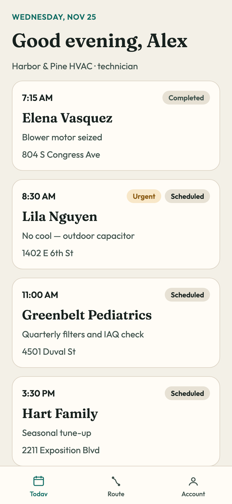
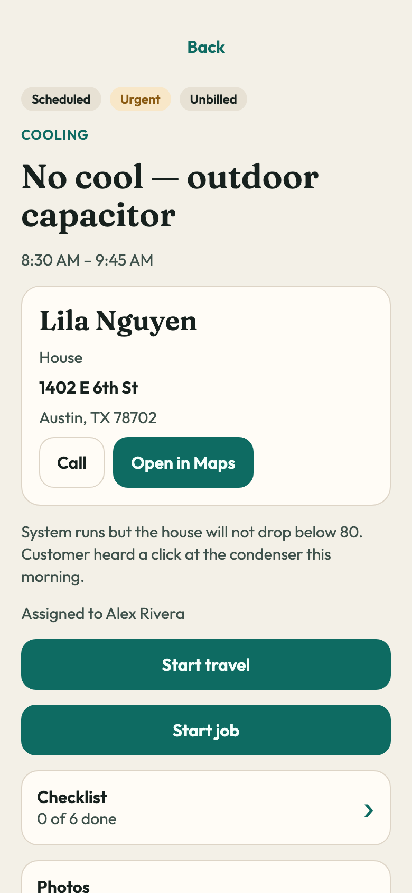
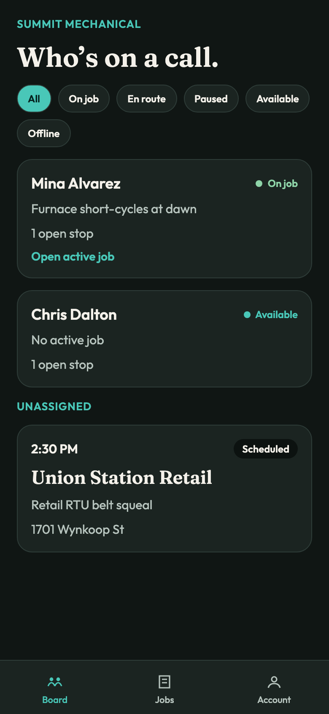

# Jobflow

Mobile companion for Jobflow, the multi-tenant field-service workspace. Technicians run the day’s route from the phone. Dispatchers see who is on a roof and move the next call. The seeded trade is HVAC: Harbor & Pine in Austin, and Summit Mechanical in Denver.

With no environment variables the app is a full demo. Point it at the same Supabase project as the web app and it uses that database under Row Level Security. The anon or publishable key is the only key this app will accept.


## Features

- Demo entry for Alex Rivera (technician) and Jordan Hale (dispatcher), plus magic-link sign-in.
- Organization switcher. Alex is a technician at Harbor & Pine and a dispatcher at Summit, so the tabs change with the company.
- Technician: today’s schedule, drive-order route, open the address in Maps, call the customer, start travel, start, pause, resume, and complete.
- Checklist, stamped field photos or the photo library, notes, customer signature, card or cash collection, and mark invoiced.
- Dispatcher: live technician status and reassignment, including unassigned urgent work.
- Light, dark, and system appearance.
- In-app alerts, with `expo-notifications` on a device. The web preview keeps the inbox local.
- Offline cache when Supabase is configured. The demo saves the workspace on the device.
- Deep links: `jobflow://job/<id>` and `https://jobflow-app.quvantic.com/job/<id>`.







## Architecture

```
src/app            expo-router screens
src/features       role screens, kept free of route wiring
src/controller     mock auth and Supabase auth
src/data           repository interface, in-memory store, Supabase gateway, offline cache
src/domain         job state machine, permissions, maps math
supabase/migrations
  shared Postgres schema and RLS for the web app and this client
```

Roles are `owner`, `dispatcher`, and `technician`. Every read and write is scoped to the signed-in organization. The mock store applies the same rules the SQL policies do. A service-role key is refused at startup.

Payments record a ledger row. Card collection is labeled as Stripe test mode. The publishable key can be present; the secret stays on the web app, never in this client.

## Mock and live mode

| Variable | Required | Purpose |
| --- | --- | --- |
| `EXPO_PUBLIC_SUPABASE_URL` | no | Supabase project URL |
| `EXPO_PUBLIC_SUPABASE_ANON_KEY` | no | Anon or publishable key |
| `EXPO_PUBLIC_STRIPE_PUBLISHABLE_KEY` | no | Shows that Stripe test mode is connected |

Leave all three empty and tap **Try the demo**.

Demo inboxes for the magic link:

- `alex.rivera@harborpine.demo`
- `jordan.hale@harborpine.demo`

Apply `supabase/migrations/20261125120000_jobflow_init.sql` on the Supabase project the web app uses. The first owner membership is created by that project’s seed or dashboard, not by this client.

## Run

```bash
npm install
npx expo start
```

- **Expo Go:** scan the QR code from `npx expo start`.
- **Web:** `npx expo start --web`, or build the static preview with `npx expo export --platform web` and serve `dist/` as a single-page app. Host target: [jobflow-app.quvantic.com](https://jobflow-app.quvantic.com).
- **EAS:** profiles in `eas.json` are `development`, `preview`, and `production`. Bundle id `com.quvantic.jobflow`. This repo does not start a paid EAS build.

```bash
npx eas build --profile preview --platform android
```

## Tests

```bash
npm run lint
npm run typecheck
npm test
npx expo export --platform web
npm run test:e2e
```

- Unit tests: Jest and React Native Testing Library, mock mode only.
- Web smoke: Playwright against the exported site (`.github/workflows/ci.yml`).
- Device flows: Maestro YAML in `.maestro/` (`technician_day`, `dispatcher_reassign`, `magic_link`). Those need a simulator or a device; CI uses Playwright instead.

```bash
maestro test .maestro/technician_day.yaml
```

## License

MIT
